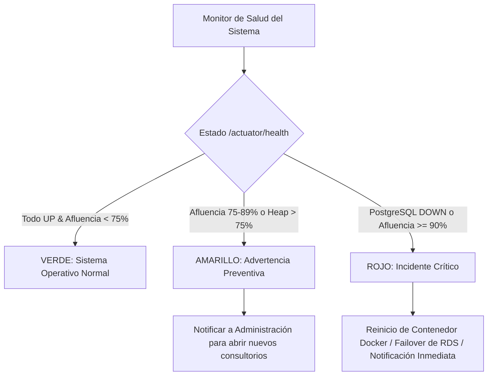

# Plan Integral de Monitoreo y Observabilidad: MediGestión
## Curso Integrador I: Sistemas - Software (UTP - Hito 80% / Semana 15)
**Sistema:** MediGestión (Plataforma Web de Gestión de Citas Médicas)  
**Entorno de Ejecución:** Spring Boot 3.3.5 / Java 21 LTS / AWS EC2 / Docker  
**Versión del Documento:** 1.0 (Noviembre 2026)

---

## 1. Introducción y Objetivos del Monitoreo

El presente plan establece la estrategia técnica y operativa para garantizar la alta disponibilidad, rendimiento, trazabilidad y detección proactiva de incidentes en la plataforma hospitalaria **MediGestión**.

### Objetivos Clave:
1. **Detección Temprana:** Identificar cuellos de botella en la base de datos o saturación de capacidad hospitalaria antes de impactar al usuario.
2. **Trazabilidad de Auditoría (MDC):** Rastrear cada interacción web de extremo a extremo mediante identificadores únicos de correlación (`traceId`).
3. **Métricas Clave:** Medir el rendimiento de la Máquina Virtual de Java (JVM), el pool de conexiones de base de datos (HikariCP) y la latencia HTTP de los controladores.
4. **Respuesta ante Incidentes:** Definir matrices de severidad y procedimientos claros de inspección y escalamiento.

---

## 2. Estrategia de Logging Estructurado (Logback + SLF4J + MDC)

El subsistema de registro de eventos utiliza la especificación **SLF4J** respaldada por el motor nativo **Logback**, configurado en `src/main/resources/logback-spring.xml`.

### 2.1 Niveles de Logging Implementados

| Nivel | Propósito en MediGestión | Ejemplo en Producción |
| :--- | :--- | :--- |
| **ERROR** | Fallas críticas que impiden completar una operación (p.ej., desconexión de PostgreSQL, fallo en transacciones de reserva). | `[ERROR] Error al confirmar reserva de cita: Conexión rechazada a PostgreSQL.` |
| **WARN** | Eventos anómalos pero tolerables (p.ej., capacidad hospitalaria > 75%, intento de reserva duplicada rechazada por regla de negocio). | `[WARN] Paciente con DNI 12345678 intentó reservar más de una cita en la misma semana.` |
| **INFO** | Eventos del ciclo de vida del sistema y transacciones de negocio exitosas. | `[INFO] Cita MG-20261124-01 reservada exitosamente para DNI 12345678 en Cardiología.` |
| **DEBUG** | Detalle interno de consultas DAO y parámetros (activo solo en perfil `dev`). | `[DEBUG] Consultando horarios disponibles para especialidad ID=1 entre fechas...` |

### 2.2 Trazabilidad con MDC (`traceId`)
Se implementa un filtro HTTP Servlet (`TraceIdFilter.java`) que inyecta en el **Mapped Diagnostic Context (MDC)** un UUID alfanumérico para cada solicitud entrante:
* Formato en consola/archivo: `[traceId=req-8f4b-2c1a]`
* Permite correlacionar todos los registros de auditoría asociados a una misma petición HTTP, incluso en entornos concurrentes con múltiples hilos.

### 2.3 Política de Rotación y Retención de Logs en Disco

| Parámetro | Configuración | Justificación |
| :--- | :--- | :--- |
| **Archivo Activo** | `logs/medigestion.log` | Ubicación central para monitoreo en vivo con `tail -f`. |
| **Patrón de Rotación** | `logs/archived/medigestion-%d{yyyy-MM-dd}.%i.log.gz` | Rotación diaria con compresión automática GZIP para ahorro de disco. |
| **Tamaño Máximo por Archivo** | `10 MB` | Evita archivos gigantes que dificulten su apertura y análisis. |
| **Periodo de Retención** | `30 días` | Cumplimiento normativo y de auditoría institucional. |
| **Límite Total en Disco** | `1 GB` | Protección contra agotamiento de almacenamiento en servidores AWS EC2. |

---

## 3. Herramienta de Salud y Rendimiento (Spring Boot Actuator)

El sistema expone endpoints seguros de observabilidad bajo la ruta `/actuator`, accesibles para el equipo de infraestructura y monitoreo continuo.

### 3.1 Endpoints Expuestos y Funcionalidad

* **`GET /actuator/health`**: Estado operativo global del sistema (HTTP 200 si `UP`, HTTP 503 si `DOWN`).
  * **Componente `db`:** Verifica la conectividad activa con PostgreSQL realizando la validación del socket y timeout de HikariCP.
  * **Componente `diskSpace`:** Evalúa el espacio libre disponible en el volumen de almacenamiento del servidor.
  * **Componente Personalizado `capacidadHospitalaria` (`CapacidadHospitalariaHealthIndicator`):**
    * `UP`: Afluencia hospitalaria $< 75\%$ (Operación Normal).
    * `WARN`: Afluencia hospitalaria entre $75\%$ y $89\%$ (Alta Demanda preventivo).
    * `DOWN`: Afluencia hospitalaria $\ge 90\%$ (Alerta Crítica de Saturación).

* **`GET /actuator/info`**: Metadatos de la aplicación:
  * Versión del artefacto (`v0.8.0`), perfil activo (`aws` / `dev`), hora de despliegue.

* **`GET /actuator/metrics`**: Consulta de métricas internas instrumentadas mediante **Micrometer**.

---

## 4. Métricas Clave de Rendimiento y Negocio

### 4.1 Métricas de Infraestructura y JVM

| Métrica Actuator | Descripción | Umbral de Alerta | Acción Recomendada |
| :--- | :--- | :--- | :--- |
| `jvm.memory.used` | Memoria Heap en uso por la aplicación. | $> 80\%$ del límite `Xmx` | Analizar fugas de memoria y ejecutar Garbage Collector. |
| `jvm.threads.live` | Número de hilos activos en el servidor Tomcat. | $> 150$ hilos concurrentes | Escalar réplicas o revisar llamadas bloqueantes. |
| `hikaricp.connections.active` | Conexiones PostgreSQL activas en uso. | $\ge 80\%$ del pool máximo | Aumentar pool `maximumPoolSize` o depurar queries lentas. |
| `hikaricp.connections.pending` | Hilos esperando una conexión del pool. | $> 0$ durante más de 3 seg | Cuello de botella crítico en base de datos; verificar bloqueos. |
| `http.server.requests` | Latencia media de respuesta en endpoints web. | Latencia media $> 1.5$ s | Optimizar índices de PostgreSQL o habilitar caché. |

### 4.2 Métricas de Negocio Hospitalario (Alineadas al Sistema)

| KPI Hospitalario | Endpoint / Origen | Meta Operativa | Alerta de Desvío |
| :--- | :--- | :--- | :--- |
| **Tasa de Ocupación de Cartelera** | `AdminService.calcularDashboardMetricas()` | $60\% - 85\%$ | $< 40\%$ (Baja demanda) o $> 95\%$ (Saturación) |
| **Volumen de Citas por Día** | `ReservaCitaRepository.countByFecha()` | Histórico diario según agenda | Caída abrupta $\rightarrow$ fallo en portal web |
| **Demanda Insatisfecha Acumulada** | `DemandaNoAtendidaRepository.count()` | $< 10$ registros/día | $> 20$ $\rightarrow$ Apertura urgente de nuevas ofertas |
| **Tasa de Cancelación Anticipada** | Módulo BPM-2 (`ReservaCitaDAO`) | $< 15\%$ del total | $> 25\%$ $\rightarrow$ Auditar causas de cancelación |

---

## 5. Matriz de Umbrales y Semáforo Operativo



---

## 6. Procedimientos de Inspección en Producción (Guía Rápida)

### 6.1 Inspección del Estado de Salud vía Terminal (cURL)
```bash
# Validar salud general de la aplicación
curl -i http://localhost:8080/actuator/health

# Consultar métricas de memoria JVM
curl -s http://localhost:8080/actuator/metrics/jvm.memory.used | jq

# Consultar conexiones activas de base de datos
curl -s http://localhost:8080/actuator/metrics/hikaricp.connections.active | jq
```

### 6.2 Monitoreo de Logs en Tiempo Real (AWS EC2 / Docker)
```bash
# Ver flujo de logs en vivo con trazabilidad MDC
tail -f logs/medigestion.log

# Filtrar exclusivamente errores en el sistema
grep "ERROR" logs/medigestion.log

# En entornos dockerizados:
docker logs -f --tail 100 medigestion-app
```
